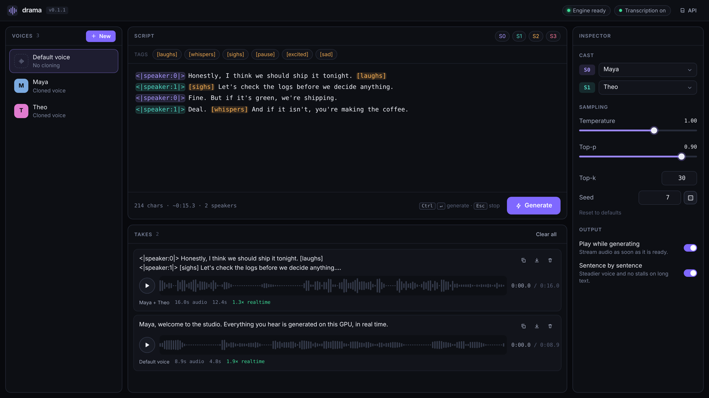

# drama-rs

Fish Audio [Drama 3](https://huggingface.co/fishaudio/drama-3) text-to-speech on a single
24 GB GPU (RTX 4090), from 6 GB with the int4 experts in RAM, or Apple Silicon using Rust + MLX and unified memory. No PyTorch at runtime.

- **Backbone**: Qwen3.5-MoE (35B total / 3B active, 40 layers, gated-DeltaNet linear attention
  + full attention every 4th layer). Routed experts are 4-bit, everything else 8-bit.
- **Codebook tower**: 13 transformer layers that predict codebooks 1–9 of every frame.
- **Codec**: the Fish modded-DAC encoder (voice cloning) and decoder, streaming and exact.

## Apple Silicon (MLX)

On an M-series Mac with macOS 15+, Rust 1.97+, CMake, Xcode command-line tools and the Metal toolchain:

```sh
(cd ui && pnpm install && pnpm build) # embed the web studio
cargo build --release --no-default-features --features mlx,cli
# Uses the existing drama-rs-v1 converted checkpoint; the usual model download/cache also works.
target/release/drama speak --model /path/to/drama-3-q4 --experts q4 --text "Hello from my Mac." --out hello.wav
```

The MLX backend runs the backbone, gated DeltaNet, routed int4 experts, audio tower and streaming codec on the
GPU. Voice-reference encoding uses the same converted codec. Q4/Q8 values are mapped losslessly to MLX's packed
affine format; weights remain quantized rather than expanding the 35B model to floating point. CPU and GPU use
the same memory pool, without pinned PCIe staging. Prefill groups rows by routed expert and bounds recurrent
computation graphs; decoding retains KV and convolution histories across calls.

Use `--no-default-features --features mlx,cli` for the CLI, or `mlx` alone for the library. CUDA remains the
default. Select exactly one backend. On MLX, `--experts auto` selects `q4`; original FP8 experts and their
RAM/VRAM placement controls remain CUDA-only. A Mac with at least 32 GB unified memory is the practical starting
point for the roughly 21 GiB checkpoint plus caches, codec and macOS. Larger contexts need more headroom.
`DRAMA_UNIFIED_MEMORY_GB` optionally sets MLX's allocator budget in GiB (default 80% of physical memory), without
changing system GPU limits. Release archives bundle `mlx.metallib` beside `drama`; Homebrew places it in
`share/drama-rs`. Keep that library when copying an installed binary. `--play` uses `ffplay` from FFmpeg on macOS.

The RTX 4090 numbers below are CUDA measurements. Mac performance and full checkpoint output parity have not
been measured; `cargo test --no-default-features --features mlx,cli --lib` checks packed quantization and
streaming state on Apple Silicon without downloading model weights.

## Footprint and speed (RTX 4090, int4 experts)

The default `--experts auto` uses the original FP8 experts when the checkpoint is present (higher quality, 1-2x
real time on a 24 GB card instead of 8.9x). These numbers are for `--experts q4`; both modes are compared
[below](#experts-where-they-run).

| | |
|---|---|
| weights on GPU (LM + codec) | ~21.4 GiB of 24 |
| decode | ~5.2 ms / frame ≈ 190 frames/s ≈ **8.9× real time** (21.5 frames = 1 s of audio) |
| prefill | ~140 ms for a 300-row prompt (text + 10 s reference voice) |
| time to first audio (streaming) | ~50–120 ms after the prompt is ready |
| codec decode | ~200× real time |

Each decode step is one CUDA-graph replay: lm_head → sampling (with RAS) → 13 tower layers
with 9 codebook samplers → backbone step for the new frame. Weight-streaming GEMVs prefetch
the next kernel's weights into L2 to hide launch gaps.

## Experts: where they run

The routed experts are 32 of the 35 B parameters, so they decide both quality and speed. Where they run:

| `--experts` | what | GPU memory | host RAM |
|---|---|---|---|
| `q4` | converted int4 experts on the GPU | ~21 GiB | small |
| `fp8-ram` | original FP8 in pinned host RAM, read over PCIe | ~4.5 GiB | ~32 GB |
| `fp8-vram` | original FP8 on the GPU | ~36 GiB | small |
| `fp8` | original FP8, **split by hardware**: as many layers in VRAM as fit, the rest in RAM | up to what's free | the remainder |
| `q4-ram` | converted int4 in pinned host RAM, a VRAM cache of the experts in use | 5 GiB and up (`--vram-gb`) | ~18 GB pinned |
| `auto` (default) | `fp8` if the original checkpoint is found and fits, else `q4`, or `q4-ram` when int4 does not fit | | |

`fp8` and `auto` look at the free VRAM and RAM at startup and print what they chose, for example
`original FP8 experts: 23/40 layers in VRAM (18.5 GB), 17 in host RAM (13.7 GB)`. A bigger GPU puts more layers
in VRAM, and with all 40 there the host RAM is not needed at all. `auto` falls back to `q4` if the original is
missing or the RAM left for the offloaded layers is short. `fp8-vram` fails with the number of layers that would fit
when the card is too small.

Advanced controls:

- `--fp8-vram-layers N`: put exactly N layers' experts in VRAM (with `--experts fp8` or `auto`), the rest in RAM.
- `--vram-reserve-gb G` (default 3): VRAM kept free for the CUDA context, KV caches, scratch buffers and codec when
  placing experts. Raise it for a larger `--max-len` or `--chunk`, or if another process uses the GPU.

Measured on an RTX 4090 (24 GB, PCIe 4.0 x16), decoding one sentence:

| | `q4` | `fp8` (auto: 23/40 layers in VRAM) | `--fp8-vram-layers 10` | `fp8-ram` |
|---|---|---|---|---|
| decode speed | 8.9x real time | 2.2x | 1.4x | 1.1x |
| time to first audio | ~150 ms | ~490 ms | ~690 ms | ~1 s |
| GPU memory | ~21 GiB | ~21 GiB | ~11 GiB | ~4 GiB |
| host RAM | small | ~14 GB pinned | ~24 GB | ~32 GB |
| KL vs original FP8 (main / heads) | 0.015 / 0.007-0.0085 | 0.010 / ~0.006 | same as `fp8` | same as `fp8` |

Every FP8 placement computes the same numbers: the audio is byte-identical across them, only the memory the experts
sit in changes. `fp8-vram` itself is not benchmarked: it needs a card with about 36 GB free, and the speed of the
split placements is the reason to expect it to approach `q4`'s (decode is memory-bandwidth-bound, and FP8 reads twice
the bytes of int4).

Tradeoffs:

- **FP8 is the higher-quality choice.** `q4` is for low latency, streaming into a conversation, or machines without
  the RAM or the original checkpoint. Parakeet ASR transcribed both identically on the test sentence; the quality
  gap is in the logit distributions (KL above), not a visible regression.
- **Speed scales with how many layers sit in VRAM** and with PCIe bandwidth for the rest: decode reads ~1 GB of
  experts per frame from RAM, so a PCIe 3.0 or x8 slot slows the RAM share (inferred, not measured).
- **Startup is longer** with FP8: the experts are copied into pinned RAM and VRAM (13-30 s versus ~10 s).
- **Disk:** FP8 needs both directories (60 GB); `q4` only `drama-3-q4` (21 GB).
- Dense linears are int8 in every mode, so FP8 is closer to the original but not bit-exact. KL is teacher-forced on each
  engine's own sampled frames over one utterance (`tools/check_engine.py --experts fp8|q4 --original models/drama-3`).

### Smaller GPUs: int4 experts in RAM (`q4-ram`)

`--experts q4-ram`, or `auto` when int4 does not fit, with `--vram-gb N` (C ABI: `drama_load_ex`) capping the VRAM the
engine takes, codec included (0, the default: what is free). When the whole model does not fit, the 18 GB of routed experts stay in page-locked RAM
and the rest of the limit becomes a VRAM cache of experts shared by all layers. A decode step uses 8 of a layer's
256 experts: a kernel inside the CUDA graph looks them up and copies the missing ones from RAM over PCIe, so the
step stays one graph replay. Eviction is GCLOCK (a hit raises a slot's count up to 3, the hand lowers it), all state
on the GPU. The prefill reads cached experts from their slots and streams the others, 64 at a time. A prompt whose
voice part (the reference) is the same as the last one starts from the saved state after it, so only the text is
prefilled. The codec's encoder (it runs once per reference voice) reads its weights from page-locked RAM too, which
leaves 0.4 GiB more to the cache. The output is bit-identical to the experts-in-VRAM run; a smaller cache only means
more copies.

Measured on an RTX 4090 (PCIe 4.0 x16) with a cloned voice, the second and third of three sentences (the cache is
warm, the voice part is reused), `--vram-gb` limiting the engine as a smaller card would:

| `--vram-gb` | expert cache | cache hits | speed | first audio |
|---|---|---|---|---|
| 0 (whole model) | – | – | 7.9× real time | 60 ms |
| 12 | 7.4 GiB | 85% | 4.7× | 220 ms |
| 8 | 3.4 GiB | 61% | 2.95× | 290 ms |
| 6 | 1.4 GiB | 39% | 2.25× | 325 ms |
| 5 | 0.4 GiB | 0% | 1.6× | 365 ms |

The engine needs about 4.8 GiB besides the cache (LM weights 2.8, codec decoder 0.4, buffers 0.7, the codec's working
memory 0.75), so a 6 GB card, with about 5 GiB free, runs it. With the default limit (0) the engine takes what is free
less a sixteenth of it (256 MiB to 1 GiB). A cache smaller than one step's 320 experts gets no hits: every expert of
the step is copied.

The first sentence after loading is slower (about 1.1 s to the first audio), as the empty cache fills.

**RAM: at least 32 GB.** The experts take 18.1 GB of page-locked memory. Windows page-locks only about half of the
RAM for one process, so by default the engine page-locks at most 45% of the RAM (75% on Linux; `DRAMA_PIN_CAP_GB`
sets it); the experts past that stay in the mapped model files, and the CPU (AVX2) computes the ones the cache does
not hold. On a 32 GB machine that is about 3 GB of experts: at an 8 GiB limit 2.2× real time, 335 ms to the first
audio (the CPU's arithmetic differs from the GPU's, so the audio is not bit-identical, the speech is the same).
With 16 GB of RAM the experts do not fit at all.

## Quantization

`tools/convert.py` reads the original checkpoint shard by shard:

| tensor | format |
|---|---|
| routed experts (32B params, FP8 in the checkpoint) | int4, asymmetric, group 64, f16 scale+min, MSE clip search |
| attention / DeltaNet / shared expert / tower linears | int8, symmetric, group 128 |
| lm_head | only the 4097 sampleable rows (EOS + semantic band), bf16 |
| embeddings, router | bf16 |

## Install

Release packaging supports Linux x86_64 (CUDA 12 runtime, Ampere or newer) and Apple Silicon (macOS 15+) on the
[releases page](https://github.com/apiplant/drama-rs/releases), and packaged:

```bash
brew install apiplant/tap/drama-rs     # Homebrew on Linux or Apple Silicon
sudo apt install drama-rs              # apt.apiplant.com
sudo pacman -S drama-rs                # apiplant.github.io/pacman
cargo install drama-rs                 # from crates.io (needs nvcc; DRAMA_CUDA_ARCH, default sm_89)
```

Repository setup for apt and pacman is in [`packaging/README.md`](packaging/README.md#using-the-packages).
As a library: `cargo add drama-rs --no-default-features` (drops clap, ureq and ntex); see `src/lib.rs` for an example.

## Model directories

Two directories make a model, and drama uses both when it can:

| directory | what | size | needed for |
|---|---|---|---|
| `drama-3-q4` | converted build: dense int8 weights, int4 experts, codec, tokenizer | 21 GB | always (dense weights, codec, tokenizer) |
| `drama-3` | the original [fishaudio/drama-3](https://huggingface.co/fishaudio/drama-3) checkpoint (block-FP8) | 39 GB | FP8 experts (optional, higher quality) |

Each is looked up in `models/<name>` in the working directory, its parent or next to the binary, then in
`~/.cache/drama-rs/<name>` (`$XDG_CACHE_HOME/drama-rs`), where they can be symlinks:

```bash
ln -s /path/to/drama-3-q4 ~/.cache/drama-rs/drama-3-q4
ln -s /path/to/drama-3    ~/.cache/drama-rs/drama-3
```

- `--model` (or `$DRAMA_MODEL`) names either directory. Given the original, the int4 build is still found
  (or downloaded) for the dense weights; `--fp8-model` (or `$DRAMA_FP8_MODEL`) names the original explicitly.
- A missing `drama-3-q4` is downloaded from [apiplant/drama-q4](https://huggingface.co/apiplant/drama-q4)
  (about 21 GB) into `~/.cache/drama-rs/drama-3-q4`. The old `drama-q4` name is still found. The original is never
  downloaded for you: `hf download fishaudio/drama-3 --local-dir models/drama-3`.
- `--experts auto` (default) runs the original FP8 experts if the original is found and fits, otherwise the int4
  experts, and says which on startup. See the next section for the choices.

## Setup

```bash
# 1. weights: the prebuilt int4 build (no conversion needed), plus the original checkpoint for FP8 experts
hf download apiplant/drama-q4 --local-dir models/drama-3-q4
hf download fishaudio/drama-3 --local-dir models/drama-3      # optional, 39 GB: higher quality, see below

# 2. build (CUDA toolkit in /opt/cuda, or set CUDA_PATH; DRAMA_CUDA_ARCH defaults to sm_89,
#    a comma-separated list such as sm_86,sm_89 builds for several GPUs; DRAMA_CUDA_NO_PTX=1 omits
#    the PTX, so only the listed GPUs run. On Windows, build from a VS developer prompt)
cargo build --release
```

### Converting from the original checkpoint (optional)

To rebuild the quantized weights yourself from the original FP8 checkpoint:

```bash
hf download fishaudio/drama-3 --local-dir models/drama-3   # 42 GB

# needs a CUDA PyTorch; ~1 min per layer is plenty
python tools/convert.py models/drama-3 models/drama-3-q4
python tools/convert_codec.py models/drama-3/codec.pth models/drama-3-q4/codec.safetensors
cp models/drama-3/tokenizer.json models/drama-3-q4/
```

## Usage

The examples use the default experts (FP8 when `models/drama-3` is there, split between VRAM and RAM by what
the GPU has free, else int4). Add `--experts q4` for low latency (8.9x real time, first audio in ~150 ms).

```bash
# speak to a file
drama speak --model models/drama-3-q4 --text "Hello there." --out hello.wav

# stream to the speakers while generating (PipeWire / pw-play)
drama speak --model models/drama-3-q4 --text "Hello there." --play

# clone a voice from a reference clip and its transcript
drama speak --model models/drama-3-q4 --play \
  --ref-wav voice.wav --ref-text "Exactly what is said in voice.wav." \
  --text "<|speaker:0|> [sighs] Fine. If we miss it, it's on you."

# on a smaller card: at most 8 GiB of VRAM, the routed experts in RAM
./target/release/drama speak --model models/drama-3-q4 --vram-gb 8 --text "Hello there." --out hello.wav

# keep the model loaded and speak every line typed on stdin
drama speak --model models/drama-3-q4 --interactive --play
```

Text is generated one sentence at a time, like the reference server's streaming endpoint.
Without a voice reference, Drama 3 often never ends after a sentence-final full stop when more
text follows. It fills the rest with silence: about a quarter of runs, measured on both the
original FP8 weights and this int4 build. Speaking each sentence on its own avoids that. A
speaker with no `--ref-wav` gets their own first sentence as the reference for the rest, so the
voice stays the same, and a sentence that still stalls is cut at a length cap and said again.
`--no-split` turns all of this off.

Sampling defaults follow the reference server: `--temperature 1.0 --top-k 30 --top-p 0.9`,
plus repetition-aware sampling over the last 16 frames. Multi-speaker text uses
`<|speaker:N|>` tags (N in 0..15); inline tags like `[laughs]` are passed through.

### HTTP server

```bash
drama serve                                   # http://127.0.0.1:8080; --addr 0.0.0.0:8080 to expose it
drama serve --voice me=voice.wav="Exactly what is said in voice.wav."   # preload voices (repeatable)

curl localhost:8080/v1/speak -d '{"text": "Hello there."}' -o hello.wav
curl localhost:8080/v1/speak -d 'Plain text works too.' -o hi.wav
curl -sN "localhost:8080/v1/speak?stream=1" -d '{"text": "Streams while it renders."}' | pw-play -   # or ffplay -
curl "localhost:8080/v1/voices?name=me&text=Exactly%20what%20is%20said." --data-binary @voice.wav
curl localhost:8080/v1/speak -d '{"text": "In my voice.", "voice": "me", "seed": 7}' -o me.wav

# dialogue: alice is <|speaker:0|>, bob <|speaker:1|> (or {"0": "alice", "1": "bob"})
curl localhost:8080/v1/speak -o talk.wav -d '{"voices": ["alice", "bob"],
  "text": "<|speaker:0|> Are you coming? <|speaker:1|> [sighs] Fine, give me a minute."}'
```

`POST /v1/speak` takes JSON (`text`, and optionally `voice`, `voices`, `stream`, `temperature`, `top_k`, `top_p`, `seed`,
`split`, `max_new`) or the text as a plain body, and returns 44.1 kHz mono 16-bit WAV. With `stream` the WAV is sent
while it is generated. `GET /v1/voices` lists the voices and `GET /health` returns `ok`. One GPU engine serves
requests in order. The server is the `serve` feature (ntex), which needs Rust 1.97.

Open `http://127.0.0.1:8080/` for the web UI, a small studio built into the binary: a script editor that highlights
speaker and `[laughs]`-style tags, a voice library (drop in or record a clip), per-speaker casting, sampling controls,
audio that plays while it is generated (buffered so it never stalls on a GPU slower than real time) and a list of takes
with waveforms and WAV download. `/docs` has the API reference (OpenAPI 3.1 at `/openapi.json`).



When the [`fluid-speech`](https://fluid-speech-rs.apiplant.com) binary is on `PATH` (or named by `$FLUID_SPEECH`), the
server can transcribe: `POST /v1/transcribe` takes an audio clip and returns `{"text": ...}`, and registering a voice
without `text` transcribes the clip for you (the UI does this as soon as you add one). It runs on the CPU so the GPU stays
with the TTS model (`DRAMA_TRANSCRIBE_DEVICE` overrides that). Without the binary transcription is disabled: `GET /v1/info`
says so, the UI shows a link to install it, and you type transcripts by hand. `fluid-speech` is not bundled.

The UI lives in `ui/` (Solid 2 + Tailwind) and is embedded at build time: run `pnpm install && pnpm build` in `ui/`
before `cargo build`, or the binary serves the API without it.

Other commands: `encode` / `decode` (codec only), `bench` (decode speed), `trace` (engine tests).

## Tests

All checks compare against a plain-PyTorch reference (`tools/reference.py`):

```bash
PY=python  # a CUDA PyTorch
$PY tools/make_tiny.py models/drama-3/config.json test/tiny-src --tokenizer models/drama-3/tokenizer.json
$PY tools/convert.py test/tiny-src test/tiny
$PY tools/check_engine.py test/tiny                     # engine logits vs reference, per step
# int4 vs original FP8 (KL, top-1), on a real prompt: random rows make the model emit EOS,
# which never happens mid-utterance in real use and skews the codebook-head comparison
drama speak --model models/drama-3-q4 --text "..." --out x.wav --prompt-out test/work/prompt.bin
$PY tools/check_engine.py models/drama-3-q4 --original models/drama-3 --rows-file test/work/prompt.bin --steps 12
$PY tools/check_codec.py models/drama-3/codec.pth clip.wav test/work models/drama-3-q4/codec.safetensors
```

`tools/make_bench_model.py` writes a full-size random model for speed/memory tests without the
download.

## Layout

```
kernels/drama.cu   LM kernels: int8/int4 GEMVs, fused MoE, gated DeltaNet, attention, sampling
kernels/codec.cu   codec kernels: im2col, snake, ConvNeXt, windowed attention, VQ encode
src/engine.rs      prefill (cuBLAS + grouped MoE) and the graph-captured decode step
src/codec.rs       streaming codec decoder, encoder, resampler
src/tts.rs         prompt -> frames -> audio pipeline, LM and codec overlapped
ref/               upstream sources used as the reference (sglang-omni, codec)
```
